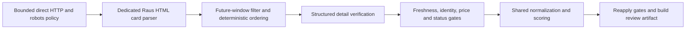

# Rausgegangen direct HTML pipeline — 31 October 2026

Branch: `codex/restore-before-tinyfish-search`. This implementation reuses main's
successful **direct HTML** approach, not its former Jina-markdown scanner. Main's
25 October run found 189 candidates and retained 150 rows; see
[the main-branch comparison](RAUSGEGANGEN_ANALYSIS.md).

**Offline technical qualification passes. Live extraction remains NO-GO.** Fresh
robots responses still deny `BerlinEventEvidence/1.0`; no current listing or detail
page has been retrieved by this implementation. No production data was changed,
branch merged, scheduling enabled or Pages deployment performed.

## Production path



`scripts/raus_html.py` is shared by the production generic-scraper CLI,
`qualify_raus_html.py`, and the existing all-source review builder's Raus matcher
and publication gates. Other source matchers and the shared model, scorer and
frontend remain unchanged from the restored baseline.

The direct transport retains main's negotiation headers and session cookies, but
identifies the actual crawler and checks robots before page retrieval. It retains
TLS verification and the managed transport. There is no automatic Jina, TinyFish,
Camofox/Camoufox or CloakBrowser escalation for this path. A 403/429 blocks further
same-host attempts within the HTTP context; denied/unknown robots policies fail
closed. Production snapshots reuse the actual cached listing document instead of
making a later request that might save a different challenge response.

The parser accepts only official event anchors with an unambiguous card-local
heading and performance date/time. It never reconstructs names from URL slugs or
borrows a day, title, price or venue from another card. A short month/day may
inherit a year only when the explicit URL window resolves it uniquely. Decimal
prices are not dates. Conflicting duplicate identities/venues are rejected;
locale aliases and responsive duplicates collapse consistently.

Ordering is explicit: local date, time, folded title, folded venue, event slug,
then exact URL/title/venue tie-breakers. Offers are also deduplicated and ordered,
so reversed card or offer order does not alter the substantive output. The shared
Pages scorer retains its existing day/price presentation order.

## Verification and publication rules

- Require the requested/final official event identity, matching title and Berlin
  performance date/time. ISO offsets convert to Europe/Berlin before matching.
  A known venue disagreement rejects. If the card lacks a venue, exact canonical
  identity plus matching title/date/time and an explicit Berlin detail venue can
  fill it. Generic locations such as “Bühne”, “Various” or “Berlin” do not qualify.
- Verify schema.org Event metadata belonging to that performance. Related cards,
  a different performance, conflicting duplicate Event nodes or a mismatched page
  h1 cannot supply evidence. Historical semantic-header candidates can still be
  discovered separately, but this publication path requires structured evidence.
- Publish only future occurrences inside the selected window with a matching
  observation no older than six hours. Future-dated timestamps and stale
  observations reject. Sold-out, cancelled and postponed observations reject.
- Use explicit EUR ordinary-admission offers for numeric public prices. Keep
  student offers separately; companion/member/child/other restricted offers do
  not establish ordinary admission. Respect explicit offer validity dates.
  Unknown admission remains UNKNOWN and cannot qualify as free or as a validated
  Community/newsletter event. An ordinary price above €20 rejects; a supported
  range is displayed as a range.
- Reapply the same gate after legacy normalization/enrichment and scoring so
  promotional “free” text or a student price cannot reappear as public admission.
  Listing text cannot assign ticket inventory. Unsampled rows do not publish.
  Generic recovery cannot reintroduce Raus rows or repeatedly probe a denied host.

These build-time gates do not add a browser-side automatic refresh or expiry
mechanism to the historical frontend. A future production release still needs an
explicit refresh policy; no daily verifier is activated by this change.

## Budgets and safe qualification

The dedicated production/qualification path allows ten total direct HTTP attempts
(including robots and redirects), at most six detail targets, 1.5 MB per response,
10 MB total response content, an 8-second connect/12-second read timeout and a
180-second network deadline. Unknown/denied permission consumes no page attempts.
The all-source review keeps its existing shared 40-detail-attempt and 600-second
network budgets, with at most six Raus and two other samples per source.

The manual workflow now supports `scope=raus_direct`. It runs the full Python test
suite and the actual production Raus pipeline, uploads sanitized diagnostics and
**cannot deploy**, even if `publish=true` is supplied. Default scope remains `all`;
normal publication still needs the existing explicit branch and publish guards.

```bash
gh workflow run fetch-strategy-probe.yml \
  --repo JsonLord/event-scraper-github-actions \
  --ref codex/restore-before-tinyfish-search \
  -f scope=raus_direct -f publish=false
```

Weekly date placeholders now use Europe/Berlin rather than UTC, consistent with
the Raus filter and manual qualification at midnight. The weekly trigger itself
was not changed or run. Existing main's Sunday writer remains a separate release
risk; this branch has not been merged into main.

## Fixtures and measured evidence

All **245 local Python tests pass**, preserving the prior 205-test baseline. New
tests cover card isolation, deterministic aliases/offers/order, missing-venue
fallback, wrong city/identity/date/time, multiple performances, conditional/student
prices, offer/observation expiry, negative statuses and bounded transport behavior.
Integration tests execute the real production CLI and shared review-site builder,
including normalization, scoring, final re-gating and artifact checksums.

The recovered `scrape-rausgegangen_de` artifact from main run `40225678325`
contains 150 extracted records, but its saved HTML is a **challenge page**. Main
fetched the listing again when saving a snapshot, after extraction/enrichment.
The snapshot therefore is not the successful listing DOM. Eight real extracted
records and that sanitized failure page are preserved. Tests explicitly reconstruct
card relationships from those records; their markup and synthetic JSON-LD are
**not represented as real source HTML or new live event evidence**. Existing
museum, Volksbühne and Berlin Bühnen captured fixtures continue to pass.

Three local live invocations are preserved in
[the diagnostic evidence](evidence/raus-html-live-2026-10-31.json). Each made one
HTTP 200 robots request and then stopped with `robots_denied`. Across those
invocations: **three robots requests, zero listing/detail requests, zero verified
or publishable occurrences, zero provider/browser calls**. The unchanged policy
hash is `5f7beefec6a2f04e6adaa2d3607ae2154d4e7820caa55c1ef202f0e10734b99b`.

Consequently, offline parser and gate behavior is qualified against the stated
fixture representations; compatibility with the current real listing DOM is not.
A permitted current listing/detail capture remains necessary before a Raus
production GO. Search candidates, successful policy HTTP responses, passing tests
and nonempty historical records are not substituted for that qualification.
